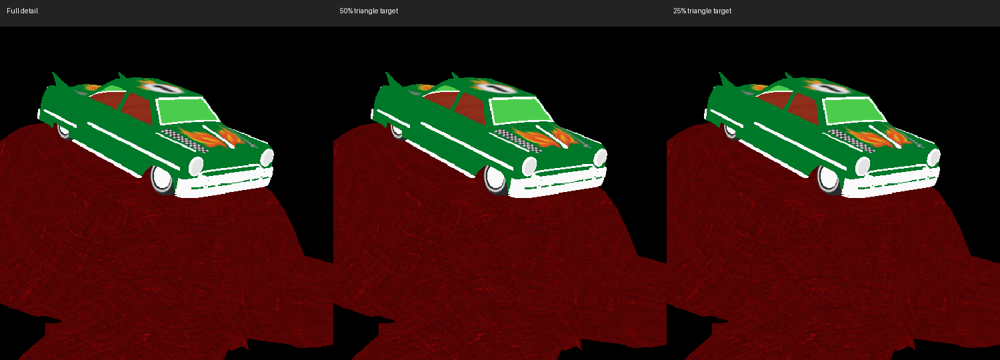

# Bounded-error model detail investigation

Fixed-detail GPU simplification improves both native moving-model workloads.
It remains a test-only experiment pending headset visual acceptance and a
production API/selection design. Production continues rendering full geometry;
this work changes no public API or quality default.

## Geometry and visual validation

The prototype uses the pinned meshoptimizer attribute-aware simplifier, UV
weights of 0.1, locked topological borders and a relative combined error limit
of 0.001. The target is a triangle budget, not a forced reduction. Geometry stays
within its material primitive; every selected position and UV is an original
vertex. Opaque indexed static primitives are eligible; masked/blended primitives
and animated/skinned/morph assets retain full detail. CPU vertices, picking and
collider inputs remain unchanged. Both eyes and all color/depth passes use the
same selected stream.

| Asset | Full triangles | 50% target | 25% target |
|---|---:|---:|---:|
| ToyCar | 108,936 | 54,464 | 28,138 |
| Avocado | 682 | 650 | 650 |

The quarter target stops above its requested budget in one ToyCar primitive.
Avocado barely reduces at either target: the error limit takes priority over
triangle count. The largest recorded simplifier error is below 0.001. This metric
is relative to primitive extents and includes attributes; it is not a guaranteed
screen-space displacement or a headset quality verdict.

`lod-pixels` renders 144 stereo comparisons across three object sizes, three
rotations, both targets, and two pixel densities. Geometry reduction is lossy;
these views measure differences rather than asserting exact equality. Full CPU
vertex vectors and picking counts remain intact; guarded fallbacks, GL errors
and metadata cleanup are checked. Production occlusion and instancing pixel
regressions also pass with the experimental path excluded.

The following crop shows the same close view at full detail and both targets.
All columns use the same crop and nearest-neighbor magnification. Inspection
showed similar silhouettes and textures; headset motion and switching still
require visual review.

At the original test density, ToyCar's maximum whole-frame RGBA RMS difference
is 0.69/255 at the half target and 0.98/255 at the quarter target. Maximum alpha
coverage changes are 6 and 9 pixels respectively. At four times the pixel density,
those RMS values rise to 2.42 and 3.50, with 82 and 167 coverage changes. These
are maxima over the sampled sizes/rotations/eyes, not general quality bounds.
Raw metrics include reference coverage so background pixels are not mistaken
for model detail.

## Native Frame comparisons

Each target has its own two 16-second original/candidate pairs per workload,
with reversed ordering on the second round. Mesh-cache optimization is on in both
paths; instancing and other geometry/shader experiments are off. GPU timing
excludes six seconds of warmup, FPS uses late samples, and the runner rejects
GPU errors, fence failures, disjoint queries or mismatched allocation sizes.

| Target | Scene | Pair | Full FPS | Reduced FPS | Full GPU ms | Reduced GPU ms |
|---|---|---:|---:|---:|---:|---:|
| 50% | 32-cars-fixed | 1 | 49.83 | 66.08 | 15.73 | 9.06 |
| 50% | 32-cars-fixed | 2 | 47.98 | 61.11 | 16.34 | 11.39 |
| 50% | 128-models-fixed | 1 | 34.09 | 38.45 | 21.53 | 17.72 |
| 50% | 128-models-fixed | 2 | 34.52 | 37.97 | 21.14 | 18.37 |
| 25% | 32-cars-fixed | 1 | 47.33 | 71.92 | 15.93 | 5.94 |
| 25% | 32-cars-fixed | 2 | 46.26 | 71.83 | 16.63 | 5.73 |
| 25% | 128-models-fixed | 1 | 30.55 | 51.33 | 24.23 | 11.80 |
| 25% | 128-models-fixed | 2 | 30.10 | 49.99 | 24.58 | 12.18 |

Original vertex/index allocation capacities are retained, with unused index
storage padded but excluded from actual draws. This deliberately holds owned
GPU storage constant and isolates rendering work; it does not measure potential
memory savings. Grouped peaks are 468 MiB in every retained run, within the
512 MiB budget. One-time simplification costs about 0.1 seconds for ToyCar and
less than 1 ms for Avocado in these runs; these costs precede timed steady state.
The same reduced draw counts feed the profiling counters.

## Remaining implementation requirements

A production feature needs an explicit script policy, retained full-detail
geometry for nearby inspection, bounded screen-space selection with hysteresis,
and one coherent detail choice per object/frame across eyes and all surfaces.
Headset validation must cover close inspection, motion, level transitions,
mask/occlusion edges, grabbing and physics. This fixed-detail experiment tests
neither automatic selection nor transition quality. Do not enable a lossy
quality default on this evidence alone.

## Artifacts and reproduction

- [Matched native timing](lod-frame.json).
- [All upload/error and per-view pixel measurements](lod-pixels-frame.txt).
- [Regression results and tested source/binary hashes](lod-validation-frame.txt).
- [Build/run commands and experimental flag](../README.md#bounded-error-model-lod-experiment).

The base is `0c2fd22` plus this investigation. Raw Frame measurements remain at
`/tmp/sf-lod-comparison` and `/tmp/sf-lod-quarter`; original PPMs are under
`/tmp/sf-lod-images`. Native validation logs use `/tmp/sf-lod-pixels.log`,
`/tmp/sf-lod-production-occlusion.log` and `/tmp/sf-lod-production-instancing.log`.
