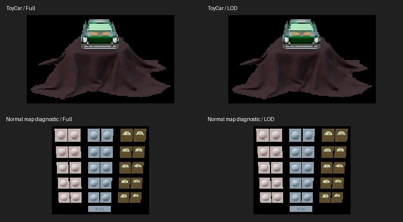

# Surface-aware PBR LOD prototype

Validated on Steam Frame on **2026-10-29**, using `efe00a3` plus this prototype.
The initial bake was excluded from production during these prototype checks.
The subsequent [budgeted production integration](pbr-lod-production.md) records
default adoption, bounded storage and additional failure/restore checks.

## Geometry and ownership

The CPU simplifier indexes all 14 position/UV/normal/tangent/handedness/map-UV
floats. It locks coincident positions with differing shader inputs, including
signed-zero-equivalent positions, and locks primitive borders. Attribute weights
are 0.1 for both UV sets, 1 for normals and tangent handedness, and 0.5 for tangent
xyz. The relative combined error limit is 0.001. This metric includes attributes
and primitive extents; it is not a screen-space or perceptual error guarantee.

Half and quarter triangle targets are requests, not forced budgets. A result must
save at least 20% of the primitive's triangles. A second level must also save at
least 20% relative to the first or it is discarded and selection falls back to
the first. Opaque static PBR primitives are eligible; mask, blend, animation,
skinning, morph, small primitives and `lod: false` retain full detail.

Selected original shader-input tuples are expanded into additional owned
position/surface VBO pairs. GPU draws stay expanded because the earlier indexed
variants regressed native throughput. Full GPU streams remain resident for near
and held objects. CPU triangles, picking, bounds, physics and materials remain
unchanged. Both eyes and every color/depth pass use the same object-level choice;
position/surface buffers and draw counts change together. Shared assets own and
release the additional buffers once, and GPU allocation estimates include them.

| ToyCar stream | Triangles |
| --- | ---: |
| Full | 108,936 |
| Reduced | 68,022 |

The strict error/seam limits stop above the half target for one opaque primitive.
The quarter attempt offers insufficient additional savings and is discarded.
The blend primitive remains full detail. Avocado and NegativeScaleTest retain
full detail in this fixture set. NormalTangentTest and NormalTangentMirrorTest
also produce one useful reduced level.

ToyCar retains **8,470,056 additional geometry bytes** (about 8.08 MiB) per shared
asset, taking position/surface geometry from 18,301,248 to 26,771,304 bytes. This is
an explicit memory tradeoff, not a memory optimization. Textures, environment
storage and retained CPU geometry are unchanged. Loading peak memory and
simplification latency have not been measured.

## Automated and image checks

- 40 exact stereo/depth/overlap comparisons against independently routed reduced
  streams passed. This verifies routing, not equality to full-detail geometry.
- Every reduced vertex preserves an exact original complete shader-input tuple.
  Full CPU position/surface arrays and picking counts remain unchanged.
- Eligibility/opt-out guards, bounded error and GPU resource cleanup passed.
- Production PBR regression passed 130 stereo/material/pose images plus API and
  persistence checks; production automatic LOD passed 26 views and its policy,
  hysteresis, restoration and ownership checks; culling passed 70 views.
- 180 lossy full/reduced comparisons cover five models, both requested levels,
  three sizes, three angles and both eyes with environment rotation. Raw
  [quality measurements](pbr-lod/quality.json) retain coverage and RGB differences.

The largest silhouette difference relative to union coverage was 0.84%, on a
small mirrored diagnostic view. ToyCar's maximum was 0.115%. Its covered RGB RMS
reached 18.16/255 on a tiny 102-pixel view, despite unchanged silhouette coverage;
large bright reflections can change at small sizes. In the larger car views,
covered RGB RMS ranged from 1.26 to 2.67/255. These measurements do not establish
that transitions are unobjectionable in motion.

The following original-resolution crops are enlarged with nearest-neighbor
sampling. Inspected car and normal-map previews retain recognizable surface
features. Headset evidence is recorded separately below.

## Matched native cost

The headset was awake and worn. One/sixteen full-detail ToyCars use the same PBR
shader, procedural studio environment, fixed geometry/transforms/camera,
alternating eyes and one 768×768 offscreen target. All detail streams are already
resident in every stage. Each requested level runs full/reduced/reduced/full,
with 30 warmup and 120 measured frames per stage. No OpenVR session, overlays or
pointer capture are created. GPU-disjoint and GL-error checks passed.

The table averages the two stage means per setting; [raw stage means](pbr-lod/samples.json)
are retained. Level 2 resolves to the same reduced stream as level 1 in this
workload, so its sequence is another comparison of that reduction, not a second
quality tier.

| Objects | Requested level | GPU ms full → reduced | CPU enqueue ms | Synchronized frame ms |
| ---: | ---: | ---: | ---: | ---: |
| 1 | 1 | .7225 → .4405 | .0168 → .0181 | 1.1482 → .9531 |
| 1 | 2 | .7614 → .4861 | .0190 → .0188 | 1.2482 → 1.1189 |
| 16 | 1 | 9.8854 → 6.2563 | .3006 → .2784 | 11.5751 → 7.8702 |
| 16 | 2 | 9.8444 → 6.3021 | .2941 → .2775 | 11.3442 → 8.0020 |

Sixteen-car GPU time improves by about 36–37% in these sequences. GPU clocks,
thermal state and scheduling are not locked; this short test does not establish
sustained performance. It measures fixed reduced detail, not automatic selection
or compositor FPS. The interactive scene uses the existing automatic policy,
including full detail while held.

## Headset acceptance

The user accepted `tests/scenes/pbr-lod.js` in the headset after trying distance
changes, grip/trigger grabbing, rotation and release with the car and normal-map
fixture. The transition log confirms ToyCar selected 68,022 triangles while not
held, then restored 108,936 triangles while held. No reduced transition was logged
for the normal-map fixture during this check; its reduced routing and quality
comparisons are covered by the offscreen tests above. Live GL-error reports were
zero. Runtime FPS varied with close-up adaptive surface resizing; these live
observations are not an equivalent-workload performance comparison.

The user also reported that distant car textures looked less pixelated. Geometry
LOD does not lower texture resolution. The PBR importer honors ToyCar's supplied
trilinear mip filter, while the legacy unlit path uses its own mip filter, and
this scene differs in object count/size and adaptive overlay allocation. The
reported appearance is accepted, but it cannot be attributed solely to this LOD
algorithm from these different scenes.
